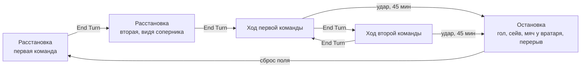

# Strategic Soccer — модель игры

Oct 14, 2026 · @valery

## Обзор

Strategic Soccer — пошаговая игра двух команд по 4 полевых игрока на клеточном поле 11×19. Движение детерминировано и подчиняется инерции, а пас, перехват, отбор и удар разрешаются случайно по явным формулам. Документ описывает правила так, как они реализованы в движке (`src/engine`); устройство кода — в [architecture.md](architecture.md), запись партий и позиций — в [notation.md](notation.md).

**Поле.** Координаты клетки — (x, y), x = 0…10 (11 столбцов), y = 1…19 (19 рядов). Строки y = 0 и y = 20 — линии ворот; ворота занимают клетки x = 4…6 в этих строках. Размер клетки на экране — 35 px.

**Команды и направления.**

| Команда | Индекс | Номера игроков | Своя половина | Атакует ворота | Стартовая позиция |
| --- | --- | --- | --- | --- | --- |
| White | 0 | 0–3 | y ≥ 10 (низ) | y = 0 (верх) | x = 0, y = 11…14 |
| Black | 1 | 4–7 | y ≤ 10 (верх) | y = 20 (низ) | x = 10, y = 6…9 |

Мяч в начале каждого розыгрыша стоит в центре, в клетке (5, 10). Вратари объявлены в данных, но физически на поле не присутствуют: их работа целиком заложена в вероятностях удара (см. «Удар по воротам»).

## Состояние игры

Полное состояние матча — структура `GameState` (`src/engine/state.h`), подробно описанная в [architecture.md](architecture.md). Ключевая идея: у каждого игрока три позиции — на начало предыдущего хода (`prevTurnStart`), на начало текущего (`turnStart`) и текущая (`pos`). Скорость с прошлого хода `Velocity() = turnStart − prevTurnStart` задаёт инерцию, смещение в текущем ходе — `Displacement() = pos − turnStart`.

| Что | Где в `GameState` |
| --- | --- |
| Игроки | `players[8]`: 0–3 White, 4–7 Black; флаги `moved`, `attacked`, направление атаки `attackDir` |
| Мяч | `ball.pos`, скорость `ball.vel`, торможение `ball.dec` = −sign(v), владелец `ball.holder` (или `kNoPlayer`) |
| Фаза полёта | `ball.stepPhase`: свободный мяч сдвигается на End Turn, когда она равна 0; переключается каждый End Turn |
| Последнее касание | `ball.lastTouchTeam` и `ball.lastTouchWasPass` (умышленный пас) — решают, кому отдать мяч, забранный вратарём |
| Фаза матча | `phase`: `Lineup` (расстановка, `lineupStep` 0 или 1), `Play`, `Finished` |
| Ход | `teamToMove`; `ballPlayed` — команда уже пасовала или била; `committed` — было случайное событие, Take Back невозможен |
| Время и счёт | `halfTurns` (время = `halfTurns`/2 минут), `score[2]` |

## Цикл хода

Игра идёт полуходами: в свой ход команда двигает любое подмножество своих игроков (каждого не более одного раза), совершает не более одного действия с мячом и завершает ход кнопкой End Turn. Удар завершает ход сам. Розыгрыш начинается с расстановки.



После расстановки команды чередуют ходы; гол, сейв с фиксацией, мяч, докатившийся до вратаря, аут и перерыв сбрасывают поле и запускают новую расстановку. Ход, прерванный рестартом посреди хода, считается сыгранным полуходом: время идёт.

**Расстановка (`phase = Lineup`).** Команды по очереди ставят игроков со стартовых позиций в любую свободную клетку своей половины; центральный ряд y = 10 доступен обеим. Каждый игрок переставляется один раз. По End Turn позиции фиксируются с нулевой инерцией (`prevTurnStart = turnStart = pos`), а игрок, поставленный на клетку мяча (5, 10), получает владение.

**Очерёдность.** Команда, расставляющаяся первой, делает и первый игровой ход; вторая расставляется, уже видя соперника. Первой расставляется:

| Ситуация | Первой расставляется |
| --- | --- |
| Начало матча | White |
| Второй тайм | Black |
| После гола | пропустившая команда |
| После того, как вратарь поймал мяч | защищавшаяся команда |
| Мяч в створе забрал вратарь | команда вратаря; после умышленного паса своему вратарю — соперник |
| Аут | соперник команды последнего касания |
| Тупик (наказание) | соперник запершей команды |

**Игровой ход (`phase = Play`).** В свой ход команда может в произвольном порядке:

- передвинуть каждого своего игрока один раз — в клетку из допустимых («Движение игроков»); владеющий мячом ведёт его с собой, а игрок, вставший на свободный мяч, подбирает его;
- один раз сыграть мячом: пас (Pass) или удар (Shot); удар — последнее действие хода;
- бороться за мяч (Attack) каждым игроком, но не более одного раза на игрока: отбирать у владеющего соперника или выковыривать запертый свободный мяч (раздел «Борьба за мяч»).

Изменения положения до End Turn предварительные: Take Back возвращает позицию на начало хода.

**Take Back** возвращает позицию на начало хода (интерфейс хранит снимок состояния). Он доступен, пока не было случайного события: подтверждённый пас, удар или отбор выставляют `take_back = 1`.

**End Turn в игре** выполняет по порядку:

1. Фиксация: `prevTurnStart ← turnStart`, `turnStart ← pos` для игроков ходившей команды; сброс `moved` и `attacked`.
2. Если мяч свободен и `stepPhase` = 0 — шаг полёта мяча с проверкой перехвата и затуханием скорости; затем `stepPhase` переключается и пересчитывается владение.
3. Передача хода сопернику, `halfTurns += 1` (полминуты).
4. Проверка времени: 45 мин → перерыв и расстановка, 90 мин → конец матча (`phase = Finished`).

Удар всегда завершает ход. Гол или сейв с фиксацией сразу запускают новую расстановку; после отбитого мяча End Turn выполняется автоматически, и к отскоку первым идёт соперник. Ход, прерванный рестартом посреди хода (гол, сейв, мяч у вратаря после паса или выбивания), считается сыгранным полуходом: `halfTurns += 1` с проверкой перерыва и конца матча.

## Движение игроков

Игрок движется с инерцией: центр допустимой области смещён на одну клетку в направлении прошлого движения, а сама область — квадрат 3×3 вокруг него. Расчёт делает `MoveDestinations` в момент выбора игрока.

**Центр и область.**

```latex
c = p + \operatorname{sign}(p - p_{prev}), \qquad \text{dest} \in \{\, c + (i, j) : i, j \in \{-1, 0, 1\} \,\}
```

Знак берётся покоординатно. Следствия:

- стоявший игрок двигается на 0–1 клетку в любую сторону, включая диагонали;
- двигавшийся по оси на +1 или +2 может по этой оси сдвинуться на 0, +1 или +2 (остановиться, сохранить темп, ускориться), но не развернуться назад;
- скорость по каждой оси ограничена 2 клетками за ход, а скорость 2 не накапливается: следующий центр снова сдвигается лишь на 1;
- разворот на 180° занимает два хода: сначала остановка, потом движение назад.

Игрок может и не двигаться в свой ход: его конечное положение совпадает с начальным, и после End Turn инерция обнуляется (это и есть остановка). На поле инерция показана отрезком от игрока до продолжения движения (`2·new − old`).

**Границы.** Клетка должна лежать в x ∈ [0, 10], y ∈ [1, 19].

**Блокировки.** Учитываются все остальные игроки обеих команд, стоящие в квадрате 3×3 вокруг центра c, по их текущим позициям `pos` (то есть уже сходившие партнёры стоят на новых местах). Клетка назначения t недоступна, если выполнено хотя бы одно:

1. В t стоит другой игрок.
2. Вертикальный ход (t в том же столбце, что старт s), и между s и t в этом столбце стоит игрок.
3. Невертикальный ход: центр клетки игрока k лежит ближе 0,707 (половина диагонали клетки) к отрезку между центрами s и t, и k находится в охватывающем прямоугольнике s–t.
4. «Коридор»: линия s–t проходит ровно через углы клеток (расстояние ≈ 0,707), и обе клетки по сторонам диагонали заняты: либо пара у цели (block1 & block2), либо пара у старта (block3 & block4). Проскочить по диагонали между двумя игроками нельзя, а мимо одного — можно.

Чужой игрок блокирует так же, как свой: контакта и фолов в модели нет.

**Подбор мяча.** Игрок, вставший на клетку свободного мяча, получает владение сразу. Кроме того, после каждого шага мяча функция `BallPosession` отдаёт мяч игроку, стоящему в его клетке.

## Мяч: владение, пас, полёт

Мяч либо у игрока и движется вместе с ним, либо свободен и катится с равномерным замедлением на 1 клетку за шаг по каждой оси. Пас наделяет мяч скоростью, равной вектору до цели.

**Владение.** `ball.holder` — номер игрока или `kNoPlayer`. Владеющий ведёт мяч с теми же правилами движения, что и без него: дриблинг не замедляет. Владение теряется при пасе, ударе или удачном отборе.

**Пас.** Последовательность: выбрать владеющего → Pass → кликнуть целевую клетку → подтвердить. Игрок может сначала пробежать с мячом, потом отдать пас. Условия и эффект:

- цель d не совпадает с пасующим и лежит не дальше 5 клеток по каждой оси (|dx| ≤ 5, |dy| ≤ 5);
- скорость мяча v = d − b, торможение dec = −sign(v) покоординатно;
- после подтверждения мяч сразу проходит первый отрезок b → d с проверкой перехвата (следующий раздел);
- если в d стоит игрок, он получает мяч без риска (игрок в целевой клетке исключён из перехвата) — в том числе соперник;
- иначе мяч остаётся свободным в d, скорость уменьшается на 1 по каждой ненулевой оси, `stepPhase` = 1.

Зона паса на экране подсвечивает ровно допустимые цели (±5 клеток по каждой оси от пасующего, внутри поля).

**Полёт свободного мяча.** Шаг мяча делается на каждом втором End Turn, когда `stepPhase` = 0:

```latex
b \leftarrow b + v \;(\text{с проверкой перехвата}), \qquad v_x \leftarrow v_x + dec_x \;\text{если } v_x \ne 0, \qquad v_y \leftarrow v_y + dec_y \;\text{если } v_y \ne 0
```

Хронология: команда A отдаёт пас (мяч сразу в d) → End Turn A (мяч стоит) → ход B, соперник видит траекторию → End Turn B (шаг мяча) → ход A → End Turn A (мяч стоит) → … Итого один шаг мяча за полный круг, и обе команды успевают среагировать.

Оси затухают независимо, поэтому диагональный пас с неравными компонентами идёт по ломаной. Полный путь по оси с начальной скоростью n — n(n+1)/2 клеток:

| Длина паса по оси, клеток | Шаги полёта | Полный путь, клеток | Полных кругов до остановки |
| --- | --- | --- | --- |
| 1 | 1 | 1 | 0 |
| 2 | 2 + 1 | 3 | 1 |
| 3 | 3 + 2 + 1 | 6 | 2 |
| 4 | 4 + 3 + 2 + 1 | 10 | 3 |
| 5 | 5 + 4 + 3 + 2 + 1 | 15 | 4 |

Мяч катится по инерции и не останавливается мгновенно. Попадание на граничную клетку (x = 0 или 10, y = 1 или 19) ещё оставляет мяч в игре; следующий шаг наружу даёт аут. Перехват или подбор на последней клетке поля предотвращает аут, если мяч **прибывает на эту клетку изнутри поля**. Если мяч уже стоит на границе и хотя бы одна компонента скорости направлена наружу, он выходит в аут сразу: боковая компонента не переносит его на соседнюю граничную клетку. При ауте счёт не меняется, ход завершается и соперник команды последнего касания начинает новую расстановку с центра. Клетки створа ворот — x = 4…6 в ряду 1 (ворота Black) и ряду 19 (ворота White). Свободный мяч, дошедший до пустой клетки створа, прежде аута забирает вратарь: счёт не меняется, поле сбрасывается. Если последним мяча касался соперник или мяч отлетел от своего игрока случайно, с центра начинает команда вратаря. Если мяч пришёл к вратарю после умышленного паса его же команды, это нарушение: с центра начинает соперник. Такой пас предупреждается заранее: если траектория паса (без учёта перехватов) заканчивается в створе своих ворот, окно подтверждения паса сообщает, что владение перейдёт сопернику. Цель паса остаётся внутри поля, поэтому мяч обычно выходит в аут на одном из следующих шагов полёта. Траектория свободного мяча рисуется до границы поля цепочкой тускнеющих кружков.

## Перехват и рикошет

Исходы каждого отрезка пути мяча (пас и каждый шаг полёта) перечисляет `SegmentOutcomes`, выбранный исход применяет `ApplySegment`. Каждый игрок рядом с линией полёта — свой или чужой — может перехватить мяч или сделать рикошет, с вероятностью, которая быстро падает с расстоянием до линии.

**Кто участвует.** Все игроки, кроме пасующего и стоящего в конечной клетке отрезка, чей центр клетки лежит в охватывающем прямоугольнике отрезка (включая границы). Игроки проверяются в том порядке, в каком до них долетает мяч (по проекции на траекторию), и первое сработавшее событие останавливает перебор.

**Вероятность.** Пусть d — расстояние от центра клетки игрока до прямой через центры начальной и конечной клеток, а r — равномерное случайное число из [0, 1]:

```latex
p(d) = 0.6\, e^{-2 d^2}; \qquad r < p^2 \Rightarrow \text{перехват}; \qquad p^2 \le r < p \Rightarrow \text{рикошет}; \qquad r \ge p \Rightarrow \text{мяч проходит}
```

| d, клеток | p | Перехват | Рикошет | Мяч проходит |
| --- | --- | --- | --- | --- |
| 0 (на линии) | 0,60 | 36% | 24% | 40% |
| 0,5 | 0,36 | 13% | 23% | 64% |
| 0,71 (угол клетки) | 0,22 | 5% | 17% | 78% |
| 1 | 0,08 | 0,7% | 7% | 92% |
| 1,5 | 0,007 | ≈0 | 0,7% | ≈99% |

Даже игрок, стоящий точно на линии, пропускает мяч в 40% случаев; два игрока на линии — в 16%.

**Исходы.**

- Перехват: мяч переходит к игроку в его клетку, полёт заканчивается.
- Рикошет: мяч переносится в случайную клетку квадрата 5×5 вокруг игрока (кроме его собственной), скорость обнуляется, мяч получает тот, кто стоит в этой клетке. Клетка выбирается только в пределах поля (x ∈ [0, 10], y ∈ [1, 19]). Рикошет и перехват меняют `last_touch` на команду коснувшегося игрока.
- Никто не сработал: мяч приходит в конечную клетку отрезка.

## Борьба за мяч (Attack)

Атака — это борьба за мяч в соседней клетке (включая диагональ). Ей можно отобрать мяч у владеющего соперника или выковырять свободный мяч, который соперник запер. Каждый игрок ходящей команды атакует не более одного раза за ход; атаковать можно в любой момент хода — до или после своего движения. Допустимость атаки определяет `GetAttackKind`, исход — `ResolveTackle` (отбор) и `ResolvePoke` (выковыривание).

**Направление.** Атаковать нельзя против своего движения — ни против скорости с предыдущего хода v₁ = `Velocity()`, ни против смещения в текущем ходе v₂ = `Displacement()`. Если d — направление на мяч (на владельца или на клетку свободного мяча), атака разрешена при d·v₁ ≥ 0 и d·v₂ ≥ 0. Вперёд и перпендикулярно можно, назад и назад по диагонали нельзя. Порядок действий не важен: если игрок атаковал до своего движения, то после атаки ему доступны только клетки, смещение в которые не направлено против атаки (остаться на месте можно всегда). Игрок, стоявший на прошлом ходу и ещё не двигавшийся, атакует в любую сторону.

### Отбор у владеющего

Атакующий стоит в соседней клетке с владеющим соперником. Несколько игроков могут атаковать одного владельца подряд — коллективный отбор задуман.

**Вероятность отбора.** h — владеющий, a — атакующий, σ = +1 для Black и −1 для White:

```latex
p = 0.35 - 0.05\,[x_h \ne x_a] + 0.05\,\sigma\,(y_h - y_a)
```

Слагаемое с σ даёт +5% за каждый ряд, на который атакующий ближе к своим воротам, чем владеющий (стоит на пути к воротам), и −5% за каждый ряд при отборе сзади.

| Положение атакующего | p (отбор) | Мяч выбит | Мяч остался |
| --- | --- | --- | --- |
| Спереди, тот же столбец | 40% | 20% | 40% |
| Спереди по диагонали | 35% | 20% | 45% |
| Сбоку, тот же ряд | 30% | 20% | 50% |
| Сзади, тот же столбец | 30% | 20% | 50% |
| Сзади по диагонали | 25% | 20% | 55% |

**Исходы** (r — случайное из [0, 1]):

- r < p — отбор: мяч переходит к атакующему;
- p ≤ r < p + 0,2 — мяч выбит: случайная клетка поля в квадрате 5×5 вокруг владеющего (кроме клеток владеющего и атакующего), скорость 0;
- r ≥ p + 0,2 — владеющий сохраняет мяч.

### Выковыривание запертого свободного мяча

Свободным мячом обычно овладевают, встав на его клетку или дождавшись, пока он докатится. Атаковать свободный мяч можно только по диагонали и только когда ход на его клетку закрыт «коридором» из двух соперников: обе клетки между атакующим и мячом заняты игроками другой команды. Если коридор открыт или в нём стоит хоть один свой игрок, выковыривать нельзя — нужно войти в клетку мяча или отвести своего игрока.

Шанс зависит от числа n соперников рядом с мячом (их всегда не меньше двух — те, что закрывают коридор):

| n | Мяч выковырян | Мяч выбит | Мяч остался |
| --- | --- | --- | --- |
| 2 | 50% | 20% | 30% |
| 3 | 35% | 20% | 45% |
| 4 | 25% | 20% | 55% |

Выбитый мяч летит в случайную клетку поля в квадрате 5×5 вокруг мяча (кроме клетки мяча и атакующего).

### После атаки

Если атака удалась, игрок может сразу отдать пас или ударить, если его команда ещё не играла мячом в этом ходе. После любой атаки Take Back недоступен.

## Тупик (запирание мяча)

Команда T заперла мяч, если ни один игрок соперника не может дойти ни до клетки мяча, ни до соседних с ней клеток: с прямой соседней клетки соперник вошёл бы в клетку мяча, с диагональной — вошёл бы или выковырял мяч, а рядом с владельцем T — атаковал бы его. Проверку делает `BallSealedBy`: поиск в ширину между клетками рядом с мячом и игроками соперника, препятствия — только игроки T (свои игроки соперник может отвести), шаги на одну клетку в 8 направлениях, диагональный шаг запрещён при закрытом коридоре. Мяч у владельца соперника запертым командой T не считается.

На практике тупик возможен только в углу (три соседние клетки заняты игроками T) или в «кармане» у угла, отгороженном стеной.

Проверка делается на каждом End Turn команды T; хранится история её трёх последних ходов.

- Мяч заперт впервые — предупреждение: T должна открыть мяч в следующий ход.
- Мяч заперт на 2 из 3 последних ходов T — мяч переходит к сопернику: сброс поля, соперник расставляется первым и начинает с центра. Правило «2 из 3» закрывает чередование «запер — открыл — запер».

## Удар по воротам

Удар разрешается мгновенно и целиком вероятностно: вратарь не имеет позиции, а шанс гола зависит от дистанции, угла и игроков между бьющим и воротами. С удара из центра в 3 клетках без помех забивается 74%, с 7 клеток — 20%. Расчёт делает `ShotProbability`, исход — `ResolveShot`.

**Условие.** Выбран владеющий мячом; бить можно после пробежки с мячом. Удар — последнее действие хода: перемещения и атаки делаются до него. Цель — центр ворот (5, T), где T = 0 для White и T = 20 для Black.

**Базовая вероятность** для бьющего в (x, y):

```latex
p_0 = e^{-0.033\, D^2} \cdot \left(1 - 0.15\,|x - 5|\right), \qquad D^2 = (x - 5)^2 + (y - T)^2
```

**Блокировка.** Каждый другой игрок (обеих команд) в зоне удара умножает вероятность на множитель от 0,6 (стоит на линии удара) до ≈ 1 (далеко от неё):

```latex
p = p_0 \cdot \prod_{k \in \text{зона}} \left(1 - \frac{0.4}{1 + \delta_k}\right)
```

Зона: столбцы от min(x, 4) до max(x, 6) и ряды от ряда бьющего (включительно) до ворот. δₖ — расстояние от центра клетки игрока до линии от бьющего к центру ворот. Множитель при δ = 0; 0,5; 1; 2 — 0,60; 0,73; 0,80; 0,87.

**Исходы** (r — случайное из [0, 1]):

| Исход | Условие | Вероятность | Что дальше |
| --- | --- | --- | --- |
| Гол | r < p | p | +1 к счёту, расстановка; первой расставляется пропустившая команда |
| Вратарь поймал | p ≤ r < 1 − p + p² | (1 − p)² | расстановка; первой расставляется защищавшаяся команда |
| Вратарь отбил | r ≥ 1 − p + p² | p(1 − p) | мяч в случайную клетку x = 3…7 в рядах 2–4 (или 16–18) перед воротами — не в створ; ход бьющей команды заканчивается, к отскоку первым идёт соперник |

Отбитый мяч — единственный исход без рестарта: игра продолжается, но следующим ходит соперник; его вероятность максимальна (25%) при p = 0,5.

**Примеры для White** (T = 0, без блокирующих):

| Позиция (x, y) | Гол | Поймал | Отбил |
| --- | --- | --- | --- |
| (5, 1) | 97% | 0,1% | 3% |
| (5, 3) | 74% | 7% | 19% |
| (3, 3) | 46% | 30% | 25% |
| (5, 5) | 44% | 32% | 25% |
| (1, 3) | 18% | 68% | 15% |
| (5, 7) | 20% | 64% | 16% |
| (5, 10) | 4% | 93% | 4% |

## Время, тайм, счёт

Матч длится 180 полуходов: каждый End Turn в игре добавляет 0,5 минуты, то есть по 45 ходов каждой команды за тайм. Ход, прерванный рестартом посреди хода (гол, сейв, мяч у вратаря после паса или выбивания), тоже засчитывается как полуход. Расстановка время не расходует, часы после гола не останавливаются и не сбрасываются.

| Событие | Когда проверяется | Последствие |
| --- | --- | --- |
| Гол | сразу после удара | +1 к счёту, сброс поля; ход засчитывается как полуход |
| Сейв с фиксацией | сразу после удара | сброс поля; ход засчитывается как полуход |
| Мяч у вратаря | свободный мяч оказался в свободной клетке створа | счёт не меняется, сброс поля; первой расставляется команда вратаря, а после умышленного паса своему вратарю — соперник |
| Аут | очередной шаг мяча выходит за пределы поля, и его не остановили на последней клетке | счёт не меняется; с центра начинает соперник команды последнего касания |
| Тупик | End Turn команды, запершей мяч на 2 из 3 последних своих ходов | сброс поля; первой расставляется соперник |
| Перерыв | 45 мин (`halfTurns` = 90) | сброс поля, первыми расставляются Black; стороны поля не меняются |
| Конец матча | 90 мин (`halfTurns` = 180) | сообщение «Game over!», матч завершён (`phase = Finished`) |

Сброс поля (`ResetField`) ставит игроков на стартовые позиции с нулевой инерцией и мяч в (5, 10). Угловых, вбрасываний, ударов от ворот и офсайда нет: любая остановка — розыгрыш с центра.

## Интерфейс и управление

Управление целиком мышью: щелчок по игроку выбирает его, щелчок по клетке перемещает. Справа от поля — кнопки хода, выбор игроков, файлы и просмотр записанных партий. Окно 820×800 px; важные события выводятся модальными MessageBox, остальные — строками состояния под кнопками.

| Кнопка | Подсветка | Действие |
| --- | --- | --- |
| Pass | зелёная, когда выбран свой владеющий и паса ещё не было | режим выбора цели паса |
| Shot | синяя, при тех же условиях | удар по воротам |
| Attack | красная, когда выбранный игрок может атаковать (`GetAttackKind`) | отбор или выковыривание |
| Take Back | голубая, пока откат доступен | отмена перемещений хода |
| End Turn | серая | завершение хода |
| White: …, Black: … | — | кто играет за команду: человек или бот из текущей коллекции (`src/bot/bot_registry.h`); щелчок перебирает human → все доступные боты → human. Можно переключать в любой момент и запустить матч двух ботов. Имена записываются в теги партии White / Black |
| New Game | — | новый матч |
| Open..., Save... | — | открыть записанную партию (`.ssn`, [notation.md](notation.md)) / сохранить текущую |
| `<<` `<` `>` `>>` | жёлтые в режиме просмотра | просмотр открытой партии: на ход назад, на действие назад, на действие вперёд, на ход вперёд |
| Play from here | жёлтая в режиме просмотра | продолжить игру с показанного момента |

Кнопки хода серые, когда ходит бот или идёт просмотр. Бот делает одно действие раз в 0,3 с, чтобы ход можно было проследить. Под кнопками — текущий ход в нотации, последние события и что задумал бот (план атаки или оценка хода защиты). Каждая партия записывается целиком, со случайными исходами, поэтому сохранённую партию можно открыть и просмотреть с любого места.

**Обозначения на поле.**

- Поле — зелёные клетки, ворота — жёлтые прямоугольники в рядах 0 и 20.
- White — белые квадраты (светло-серые после хода), Black — чёрные (тёмно-серые после хода).
- Отрезок от игрока — вектор инерции.
- Выбранный игрок — синий, его допустимые клетки — голубые.
- Зона паса — оливковые клетки.
- Мяч — красный круг, его траектория — тускнеющие жёлтые круги.
- Счёт, ходящая команда и время — текстом над кнопками.

## Известные ошибки и пробелы модели

Ошибки, найденные при разборе исходников, исправлены 14.10.2026 (прежние версии сохранены как `main.cpp.before_fixes`, `main.h.before_fixes`):

| Где | Что было | Как стало |
| --- | --- | --- |
| Pass, Attack | обращение к `ppointers[-10]`, когда мяч свободен | кнопки проверяют, что мяч у ходящей команды (Pass) или у соперника (Attack) |
| Pass, Shot, Attack | можно было играть мячом соперника и атаковать своего | проверяется команда игрока и стадия игры |
| Shot | после паса партнёру можно было сразу ударить в том же ходе; после отбитого удара — снова сыграть мячом | одно действие с мячом за ход (`passed = 2` после удара) |
| `GoalShot` | деление на ноль при x = 5 у бьющего; линия удара от позиции на начало хода | расстояние до линии считается через векторное произведение от текущей позиции |
| `Intercept` | порядок проверки по индексам игроков; на End Turn исключался случайный `selected` | порядок вдоль траектории; исключается только пасующий |
| End Turn, перехват, отбитый удар | `if(ball_posession=-10)`; скорость мяча не обнулялась | сравнение исправлено; пойманный или отбитый мяч останавливается |
| Случайные клетки | индекс мог выйти за массив; фильтр `&` вместо `\|`; клетки за полем | `RandIndex`, правильный фильтр, только клетки поля |
| Расстановка | можно было поставить игрока в ряд 0 или 20 | только ряды 1–19 |
| Подписи | фиксированная длина строк в `TextOut` | длина по строке |

При рефакторинге 15.10.2026 закрыты и два оставшихся пункта: зона паса на экране совпадает с проверяемой, после 90 минут матч завершается. Исходный код до рефакторинга лежит в `legacy/`.

**Не реализовано в модели:**

- вратари как фигуры на поле (их действие учитывается вероятностями и рестартами);
- фолы и жёлтые карточки;
- офсайд, угловые, вбрасывания, удары от ворот;
- смена сторон во втором тайме;
- навесы и высокие передачи: любой пас идёт по земле и может быть перехвачен;
- индивидуальные характеристики игроков — все восемь одинаковы;

## Решения по дизайну

Зафиксировано в обсуждениях 14–15.10.2026; это задуманное поведение, а не ошибки.

| Тема | Решение |
| --- | --- |
| Инерция мяча | Мяч после паса катится по инерции с затуханием 1 клетка/шаг; полный путь n(n+1)/2 — так задумано. |
| Пас на ход | Пас в свободную клетку — часть задумки: партнёр выбегает на траекторию и подбирает мяч. |
| Атакующий эпизод при свободном мяче | `ball.attackTeam` хранит команду, чья атака продолжается. Касание, выбивание или отражение без контролируемого перехода мяча не меняет её; подбор игроком и новый розыгрыш меняют. Это учёт для бота, не новое ограничение действий. |
| Игра в одно касание | Игрок, подобравший мяч, может в тот же ход отдать пас или ударить (если команда ещё не играла мячом в этом ходе). |
| Отбор | Атаковать можно только игрока с мячом и только с соседней клетки (включая диагональ); игрок без мяча неприкосновенен. Позже — фолы за атаку сзади. |
| Направление атаки | Атаковать нельзя против скорости с предыдущего хода и против смещения в текущем ходе (d·v < 0); перпендикулярно можно. Атаковать можно до или после движения; атаковавший до движения не может затем сместиться против направления атаки. |
| Выковыривание | Свободный мяч можно атаковать только по диагонали через коридор, закрытый двумя соперниками; шанс 50 / 35 / 25% при 2 / 3 / 4 соперниках рядом с мячом. После удачной атаки можно сразу пасовать или бить. |
| Тупик | Определяется как недостижимость мяча для соперника; первый раз — предупреждение, при запирании на 2 из 3 ходов — мяч сопернику с центра. |
| Коллективный отбор | Несколько отборов на одного владельца за ход — задумано. Владеющая мячом команда должна не допускать приёма мяча игроком, которого могут атаковать сразу несколько соперников. |
| Офсайд | Нет (как в мини-футболе). |
| Ауты (решение 19.10.2026) | При шаге за пределы поля соперник команды последнего касания начинает с центра. Граничная клетка ещё игровая; вратарь в свободном створе и игрок на последней клетке могут остановить мяч. Цель паса остаётся внутри поля. |
| Мяч у ворот | Свободный мяч в створе забирает вратарь; его команда начинает с центра, счёт не меняется. Умышленный пас своему вратарю наказывается переходом владения, о нём предупреждает окно подтверждения паса. За рикошет наказания нет. |
| Удар | Пока без выбора направления и положения вратаря: вероятность зависит только от позиции бьющего и блокирующих игроков. Вратарь-фигура — возможное развитие позже. |
| Удар завершает ход | Удар — последнее действие хода. Исходы: гол (p), вратарь поймал ((1 − p)², его команда начинает с центра), отбил (p(1 − p), игра продолжается, но к отскоку первым идёт соперник). Атака не реагирует на отскок раньше защиты (решение 15.10.2026). |
| Время при рестарте | Ход, прерванный рестартом посреди хода, считается сыгранным полуходом. Иначе удар с сейвом не тратил времени и удары от центра можно было повторять бесконечно (найдено самоигрой бота 15.10.2026). |
